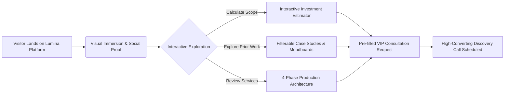
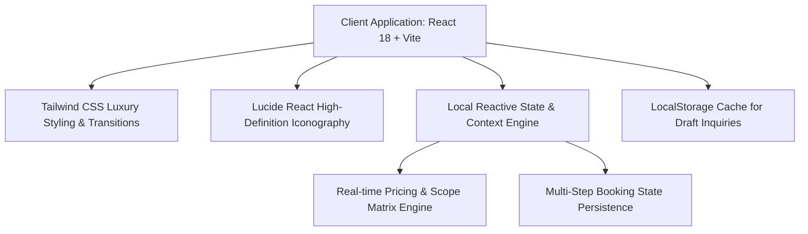

# Product Requirements Document (PRD)
## Project: Lumina & Co. Events — Digital Experience & Booking Platform
**Version:** 1.0.0  
**Date:** October 30, 2026  
**Status:** Approved for Implementation  
**Product Owner:** Lead Digital Architect & Product Strategist  

---

## 1. Executive Summary & Vision

### 1.1 Executive Summary
**Lumina & Co. Events** is a premier, full-service event design, planning, and production agency specializing in bespoke weddings, high-impact corporate galas, product launches, and exclusive private celebrations. 

The objective of this digital product is to transform Lumina & Co.'s online presence from a static brochure into an immersive, high-converting digital platform. The website combines luxury editorial visual storytelling with practical interactive tools: an **Interactive Event Investment & Budget Estimator**, a **Filterable Portfolio Showcase with Case Study Deep-Dives**, an **Interactive Style & Moodboard Palette Explorer**, and a seamless **Multi-Step Consultation Scheduler**.

### 1.2 Vision Statement
> *"To craft an effortless digital journey that mirrors the precision, artistry, and white-glove hospitality of an in-person Lumina & Co. event experience — converting high-intent visitors into committed consultation clients."*

---

## 2. Target Audience & Personas

| Persona | Demographics / Profile | Primary Goal | Key Pain Points | Platform Solution |
| :--- | :--- | :--- | :--- | :--- |
| **Eleanor & Julian (The Discerning Couple)** | Age 28–38, HNW professionals planning a high-end luxury or destination wedding (Budget: \$60k–\$250k+). | Seek an elite, trustworthy planner who can execute their bespoke aesthetic flawlessly without stress. | Vague pricing, cookie-cutter wedding packages, opaque vendor relationships. | Transparent budget estimator, curated case studies with design color palettes and moodboards. |
| **Marcus Vance (Corporate Brand Director)** | Age 35–52, VP of Marketing / Brand Operations at a high-growth tech or luxury retail firm. | Plan a seamless 400-guest summit, annual gala, or VIP product launch that reinforces brand prestige. | Tight production timelines, strict compliance/audiovisual demands, fear of logistical failure. | Clear corporate portfolio metrics (attendees, ROI, press), downloadable one-sheets, streamlined consultation scheduler. |
| **Sophia Martinez (Milestone Celebrant)** | Age 30–60, host planning an anniversary, 40th birthday weekend, or private charity salon. | Wants an unforgettable experience with bespoke gastronomy, scenography, and entertainment. | Overwhelmed by coordination, lack of creative direction, coordinating multiple vendors. | Signature 4-step process breakdown, transparent service tiers, direct private dining/entertainment add-ons. |

---

## 3. Core Value Proposition & Competitive Edge



1. **Transparent Empowerment**: Unlike competitors hiding pricing behind ambiguous forms, Lumina provides an intuitive **Event Investment Calculator** calculating ballpark allocations across guest counts, tiers, and signature add-ons.
2. **Editorial Aesthetics + Performance**: High-density visual showcase with fluid transitions, instant responsiveness, and zero lag.
3. **Frictionless Booking Flow**: Multi-step discovery wizard captures event typology, aesthetic preference, guest count, and calendar availability in under 90 seconds.

---

## 4. Information Architecture & Site Map

```
Lumina & Co. Web Platform
├── 1. Global Navigation Bar (Sticky, Glassmorphic, Brand Monogram, Quick Call/Book CTA)
├── 2. Hero Section (Editorial Title, Social Validation Badges, Primary & Secondary CTAs)
├── 3. Impact & Social Proof Ticker (500+ Events, 99.4% Client Satisfaction, Press Badges)
├── 4. Interactive Investment & Package Estimator (Real-time dynamic pricing breakdown)
├── 5. Signature Services Matrix (Weddings, Corporate Galas, Private Soirées, Destination)
├── 6. Curated Portfolio & Case Studies (Filterable grid, lightbox modal, palette swatch previews)
├── 7. The Lumina Method (4-Phase Signature Production Workflow)
├── 8. Interactive Moodboard & Aesthetic Visualizer (Visual theme explorer)
├── 9. Verified Client Testimonials & Press Accolades (Carousel with client portraits & reviews)
├── 10. Multi-Step Consultation & Inquiry Scheduler (Interactive step wizard with confirmation)
├── 11. FAQ Accordion (Pricing, timeline, destination fees, vendor exclusivity)
└── 12. Global Footer (Newsletter signup, social links, contact coordinates, copyright)
```

---

## 5. Functional Specifications (P0, P1, P2)

### 5.1 [P0] Interactive Event Investment & Package Estimator
* **Inputs**:
  - Event Type: *Luxury Wedding*, *Corporate Summit / Gala*, *Private Milestone Celebration*, *Brand Product Launch*.
  - Estimated Guest Count: Interactive range slider (25 to 800+ guests).
  - Service Level:
    - *Bespoke Full-Service Production* (End-to-end design, vendor contracting, logistics, 3D floorplans).
    - *Design & Partial Curation* (Aesthetic moodboards, decor/floral sourcing, master run-of-show).
    - *Executive Day-Of Direction* (6-week pre-event handover, vendor sync, full day-of timeline execution).
  - Add-On Elements (Multi-select check cards):
    - Curated Mixology & Gastronomy Direction
    - Custom Scenography, Floral & Architectural Lighting
    - Live Entertainment & Headliner Booking
    - High-End Cinematography & Drone Production
    - VIP Guest Concierge & Luxury Transportation
* **Outputs**:
  - Live calculated estimated investment range (Low - High estimate).
  - Itemized estimated distribution breakdown (Design & Management, Venue & Gastronomy, Decor & Scenography, Production & Media).
  - Instant CTA: *"Schedule Consultation with This Custom Scope"* which automatically transfers calculated parameters directly into the Consultation Scheduler.

### 5.2 [P0] Curated Portfolio & Deep-Dive Case Studies
* **Filtering Mechanism**: All, Luxury Weddings, Corporate Galas, Private Soirées.
* **Card Metadata**: Event Title, Category, Guest Count, Location/Venue, Main Aesthetic, Hero Photo.
* **Interactive Modal View**:
  - Full photographic gallery.
  - Event Narrative & Client Brief.
  - Design Palette Swatches (Hex codes & color names).
  - Production Highlights (Challenges solved, turnaround time, key features).
  - Client testimonial snippet.

### 5.3 [P0] Multi-Step Consultation Booking & Inquiry Wizard
* **Step 1: Event Foundation**: Event Category, Date / Target Season, Expected Guest Count, Venue Status (Secured vs. Needed).
* **Step 2: Aesthetic & Desired Experience**: Select visual vibe cards (e.g. *Timeless Black Tie*, *Architectural Modern Minimalist*, *Opulent European Romantic*, *Tech-Forward Immersive*), estimated budget bracket.
* **Step 3: Contact Details & Notes**: Name, Email, Phone, Preferred Consultation Method (Virtual Zoom, In-Studio Atelier, Phone), Special notes or dream concepts.
* **Step 4: Real-time Confirmation**: Dynamic confirmation card displaying booking summary, reference code, calendar expectation, and immediate download/print option.

### 5.4 [P1] The 4-Phase Lumina Method
Interactive visual timeline demonstrating end-to-end reliability:
1. **Phase 01: Concept & Spatial Blueprint** (Aesthetic moodboards, site inspection, budget mapping).
2. **Phase 02: Curation & Vendor Assembly** (Exclusive vendor contracts, culinary tastings, 3D renderings).
3. **Phase 03: Precision Logistics & Run of Show** (Minute-by-minute timeline, load-in blueprints, safety compliance).
4. **Phase 04: White-Glove Orchestration** (On-site command team, guest concierge, seamless execution).

### 5.5 [P1] Interactive Aesthetic & Theme Visualizer
- Allows prospective clients to sample curated aesthetic palettes (e.g., "Champagne & Obsidian Noir", "Tuscan Sun & Olive", "Gilded Romance", "Nordic Minimalist").
- Shows sample fabric swatches, recommended floral stems, lighting temperatures, and vibe tags.

### 5.6 [P2] FAQ Accordion & Quick Inquiry Modals
- High-priority answers to frequently asked questions (How far in advance to book? Do you travel internationally? Can we bring our own vendors?).
- Immediate contact modal for urgent inquiries or press requests.

---

## 6. Design System & Brand Identity Guidelines

### 6.1 Brand Tone & Philosophy
- **Keywords**: *Refined, Architectural, Luminescent, Flawless, Hospitable, Timeless.*
- **Visual Personality**: High-end fashion editorial meets architectural precision.

### 6.2 Color Palette
```
Primary Luxury Dark:    #0F141C (Deep Obsidian Midnight)
Secondary Dark:          #1A2230 (Rich Slate Charcoal)
Primary Accent Gold:     #D4AF37 (Warm Champagne Gold)
Secondary Accent Bronze: #C59B27 (Burnished Brass)
Light Foundation:        #FAF8F5 (Ivory Warm Linen)
Neutral Card Muted:      #FFFFFF (Pure Pristine White)
Text Slate Primary:      #111827 (Deep Carbon)
Text Slate Muted:        #64748B (Sophisticated Platinum Gray)
Border Subtle:           #E2E8F0 / #2D3748
```

### 6.3 Typography
- **Headings & Display**: Editorial Serif (Playfair Display / Cormorant Garamond style) paired with clean modern Sans-Serif tracking.
- **Body & Controls**: Modern Geometrics (Inter / Plus Jakarta Sans) for high readability across data tables, sliders, and form fields.

---

## 7. Technical Architecture & Tech Stack



* **Build Tooling**: Vite 5+ (Fast HMR, optimized production rollup bundle).
* **Framework**: React 18 with modern functional hooks (`useState`, `useMemo`, `useCallback`, `useEffect`).
* **Styling**: Tailwind CSS with custom theme extensions (luxury gold gradients, glassmorphism backdrop blur, bespoke shadows).
* **Icons**: `lucide-react` for crisp vector iconography.
* **Component Architecture**:
  - `Navbar.jsx`: Sticky responsive navigation with desktop menu, mobile sliding drawer, and direct consultation trigger.
  - `Hero.jsx`: High-impact editorial hero with dynamic metrics counter, dual action triggers, and video/high-res visual backdrops.
  - `Estimator.jsx`: Interactive real-time budget calculator with slider, tier toggles, dynamic breakdown chart, and booking prefill.
  - `Portfolio.jsx`: Categorized gallery with interactive modal, guest counts, color palettes, and behind-the-scenes production notes.
  - `Process.jsx`: Interactive 4-step workflow showcase with visual indicators.
  - `Services.jsx`: Expandable service tier cards with deliverables checklists.
  - `MoodboardExplorer.jsx`: Interactive aesthetic palette visualizer.
  - `Testimonials.jsx`: Client review slider with quotes, ratings, and press validation.
  - `BookingWizard.jsx`: 3-step interactive booking engine with real-time feedback and appointment confirmation.
  - `FAQ.jsx`: Accordion-based FAQs with categorized tabs.
  - `Footer.jsx`: Rich footer with newsletter sign-up, credentials, and social links.

---

## 8. Non-Functional Requirements (NFRs)

1. **Performance**: Target 95+ Google Lighthouse score across desktop and mobile. Zero render-blocking heavy external assets.
2. **Accessibility (WCAG 2.1 AA)**: High contrast ratio for text on dark and light backgrounds, ARIA labels on all interactive controls, full keyboard navigability.
3. **Responsiveness**: Pixel-perfect layout from 360px mobile viewports through 4K displays.
4. **Data Privacy**: No tracking cookies without consent. Client inquiry data is strictly handled client-side in the prototype with zero telemetry leak.

---

## 9. Success Metrics (KPIs)

- **Consultation Form Completion Rate**: > 8.5% of total unique visits.
- **Estimator Tool Engagement**: > 45% of visitors engage with guest slider or add-on selectors.
- **Time on Site**: Average > 3 minutes 30 seconds due to interactive portfolio and calculator.
- **Mobile Usability Score**: 100% compliant on tap target sizes and responsive font scales.
